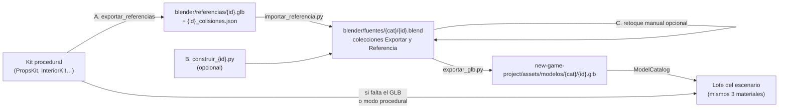

# 4. Evaluación Blender–Godot y arquitectura propuesta

## Entorno comprobado (2026-11-22)

| Herramienta | Versión | Ruta |
| --- | --- | --- |
| Godot | 4.7.2 (Steam) | `D:\Program Files (x86)\steam\steamapps\common\Godot Engine\godot.windows.opt.tools.64.exe` |
| Blender | 5.3.0 (Steam, compilado el 2026-11-10) | `D:\Program Files (x86)\steam\steamapps\common\Blender\blender.exe` |
| Exportador glTF de Blender | `io_scene_gltf2` 5.3.43 | incluido en Blender |

Blender arranca sin ventana (`--background --factory-startup --python ...`) y el operador
`bpy.ops.export_scene.gltf` está disponible: la exportación se puede automatizar desde la
terminal. Opciones reales del exportador en esta versión (consultadas con
`bpy.ops.export_scene.gltf.get_rna_type().properties`): `export_format`, `export_yup` (por
defecto verdadero), `export_apply` (**por defecto falso**), `export_normals`, `export_vertex_color`
(**por defecto `MATERIAL`**; valores `MATERIAL`, `ACTIVE`, `NAME`, `NONE`),
`export_vertex_color_name` (`Color`), `export_all_vertex_colors`, `export_materials`,
`export_lights` (falso), `export_cameras` (falso), `use_selection`, `use_active_collection`,
`export_extras`.

## Evaluación de las vías posibles

| Vía | Para qué sirve | Ventajas | Inconvenientes | Veredicto |
| --- | --- | --- | --- | --- |
| **A. Exportación automática desde Godot** (`GLTFDocument` desde una escena de herramienta que construye cada pieza aislada) | Obtener la geometría exacta de hoy como punto de partida y como referencia | Fidelidad total (mismos triángulos, colores y medidas); barata; repetible; también puede volcar la lista de colisiones | Mallas sin índices, una cara suelta por triángulo; los parámetros (anchuras, colores) quedan fijados en cada exportación | **Sí, siempre como primer paso** de cada pieza |
| **B. Reconstrucción con Python de Blender** (`bpy`) | Familias de piezas con variantes (estanterías, camas, cómodas, mesas) y el cuerpo base de los personajes con sus pivotes | Reproducible; genera variantes; malla limpia (con índices) desde el principio | Duplica la lógica de medidas en dos lenguajes; hay que mantener ambas | **Sí, sólo** cuando la pieza vaya a mejorar en Blender y tenga variantes |
| **C. Reconstrucción manual** | Piezas cuyo valor es artístico: personajes, árboles, coche, fuente, tren, fachadas | Máximo control del aspecto | Lenta; el propietario no tiene experiencia previa en modelado 3D | **Sí, al final** y partiendo siempre de A o B, nunca de cero |
| **D. GLB como formato de intercambio** | Lo que lee el juego | Un solo archivo binario; Godot lo importa sin herramientas externas; guarda jerarquía, nombres, materiales y colores de vértice | Binario (no se ve el cambio en un diff) | **Sí.** Frente a `.gltf` + `.bin`: un archivo en vez de dos y sin rutas relativas que se rompan |
| **E. Conservar `.blend` editables** | Fuente de verdad de cada modelo editado | Se pueden reabrir y retocar; guardan colecciones de referencia | Binario; Godot intenta importarlo si está dentro del proyecto | **Sí, fuera de `new-game-project/`** |
| Importar `.blend` directamente en Godot | — | Sin paso de exportación | Exige Blender instalado y configurado en el editor de **cada** equipo (`filesystem/import/blender/blender_path`); el coautor y el jurado no lo tendrían; el paso «Importación» de `verificar.ps1` fallaría | **No** |

### Combinación recomendada



1. **A** saca la pieza tal como es hoy (malla y colisiones) a `blender/referencias/`.
2. Un script de Blender la abre en un `.blend` nuevo con dos colecciones: `Exportar` (la malla que
   se editará) y `Referencia` (la original y las cajas de colisión, que nunca se exportan).
3. Se edita: a mano (**C**), con un script de construcción (**B**), o nada en el prototipo.
4. Otro script exporta la colección `Exportar` a GLB con opciones fijas y deja un registro.
5. El juego carga el GLB y **fusiona sus triángulos en el lote** del escenario. Si el GLB no existe
   o se pide el modo procedural, la pieza se dibuja con el código de hoy.

## Arquitectura en el juego

### Principio

Lo visual se sustituye; lo lógico no se toca. Cada función de kit queda así:

```gdscript
static func mailbox(location: LocationBase, where: Vector3) -> void:
	if not ModelCatalog.place(location, "buzon", Transform3D(Basis.IDENTITY, where)):
		_mailbox_mesh(location.batch, where)   # el código de hoy, sin cambios
	location.collider(where + Vector3.UP * 0.6, Vector3(0.5, 1.2, 0.5))   # igual que hoy
```

Colisiones, luces, rótulos, puntos de interacción y tipos de suelo siguen en GDScript, en la misma
llamada y con los mismos parámetros. Por construcción no cambian la navegación, el guardado, el
mapa ni las pruebas de alcance.

### Piezas nuevas (se crean a partir de la sesión 2)

| Pieza | Tipo | Responsabilidad |
| --- | --- | --- |
| `scripts/world/model_catalog.gd` (`ModelCatalog`) | `RefCounted` con funciones estáticas | Tabla id → ruta GLB; `place(location, id, transform) -> bool`; caché de superficies ya convertidas; interruptor `enabled` (modo procedural para comparar); `clear()` al cerrar |
| `MeshBatcher.add_surfaces(surfaces, transform)` | método nuevo | Añade triángulos importados a las capas del lote bajo `xform * transform`, con sus normales y colores. Capa según el nombre del material (`vs_brillo` → `GLOW`, `vs_suelo` → `GROUND`, el resto → `OPAQUE`). No consume el generador de variación |
| `new-game-project/tools/modelos/exportar_referencias.tscn` | escena de herramienta | Vía A: construye cada pieza en un `LocationBase` aislado, exporta su malla con `GLTFDocument` y su lista de colisiones en JSON |
| `blender/scripts/importar_referencia.py` | script de Blender | Crea el `.blend` con las colecciones `Exportar` y `Referencia` |
| `blender/scripts/exportar_glb.py` | script de Blender | Exporta `Exportar` a GLB con opciones fijas y escribe el registro |
| `assets/modelos/<categoría>/<id>.glb` | recurso | Modelos finales, con su `.import` |
| `tests/unit/test_models.gd` | prueba | Para cada pieza migrada: mismas colisiones en los dos modos, caja parecida, capas correctas, colores dentro de tolerancia, escenario sin mallas de más |

`GameData._exit_tree` llamará a `ModelCatalog.clear()` junto a `MaterialLibrary.clear()`.

### Por qué fusionar en el lote y no instanciar el GLB

- Mantiene las llamadas de dibujado (un escenario sigue siendo tres mallas y tres materiales).
- Respeta `test_geometry_is_batched` por lo que mide, no sólo por cómo lo cuenta.
- Usa los mismos materiales (`vertex_lit`, `glow`, `cobblestone`): el modelo nuevo recibe la misma
  luz, niebla, filtros (`PostFx`) y calidad gráfica que el resto sin hacer nada.
- Sirve para piezas con `batch.xform` (muebles girados, fachadas dentro de `BuildingKit.begin`).

Límite: sólo vale para geometría estática con color de vértice. Una pieza con textura, con
transparencia o animada necesita su propia instancia (ver abajo) y cuenta como llamadas de dibujado
nuevas, que habrá que presupuestar en la prueba de forma explícita.

### Escenas de atrezo independientes (opcional, fase posterior)

Si más adelante interesa colocar o retocar piezas desde el editor, cada una puede tener su escena,
separando lo visual de lo lógico:

```text
Farola (Node3D)                     scenes/world/atrezo/farola.tscn
├── Modelo        instancia de farola.glb        ← lo único que se cambia al remodelar
├── Colisiones    CollisionShape3D con BoxShape3D (sin StaticBody propio)
├── Luz           OmniLight3D
└── Interaccion   Marker3D (opcional: dónde va el Interactable)
```

y un único método `LocationBase.add_prop(escena, transform)` que, dentro de `build()`:

1. fusiona las mallas de `Modelo` en el lote (o las instancia si no se pueden fusionar);
2. **mueve** las formas de `Colisiones` al `StaticBody3D` `Colisiones` del escenario, para que
   entren en la navegación y en `test_map`;
3. registra las luces con `GraphicsQuality.register_light`;
4. crea los `Interactable` en sus marcadores.

No se recomienda para el prototipo: añade una capa más que probar. El camino corto
(`ModelCatalog` dentro de los kits) consigue lo mismo sin escenas nuevas.

## Personajes: conservar la interfaz de `CharacterModel`

`CharacterModel` se queda como **fachada**: el nodo `Model` de `npc.tscn` y `player.tscn`, el
`class_name`, las constantes y todos los métodos públicos siguen iguales. Lo que cambia es de
dónde salen las mallas de cada pivote.

| Se conserva | Detalle |
| --- | --- |
| `build(look)` | Misma entrada: el diccionario de `characters.json` o `PlayerController.LOOK` |
| Seis pivotes con el mismo nombre y posición | `PiernaIzq` (−0,11; 0,84; 0), `PiernaDer` (0,11; 0,84; 0), `Torso` (0; 0,84; 0), `BrazoIzq` (−0,27; 1,42; 0), `BrazoDer` (0,27; 1,42; 0), `Cabeza` (0; 1,50; 0), en metros y ejes de Godot |
| Animación procedural en `_process` | Rota y desplaza los pivotes como hoy: no hace falta esqueleto ni `AnimationPlayer` |
| `set_motion`, `set_talking`, `is_talking`, `set_head_turn`, `set_head_tilt`, `set_fade`, señal `stepped` | Sin cambios |
| Escala por `height` | Se aplica al nodo `Model` como hoy |
| Mirada hacia −Z | El GLB se exporta ya mirando a −Z (ver estándares); **no** se gira con un nodo intermedio, porque invertiría el signo de `set_head_tilt` |

Diseño del GLB de personaje:

- Un objeto por pivote, con el **origen en el punto del pivote** y el mismo nombre. `CharacterModel`
  sustituye en cada pivote la malla procedural por la del GLB.
- Las piezas opcionales son objetos aparte, hijos de su pivote, con nombre por tipo:
  `Pelo_short`, `Pelo_curly`, `Sombrero_fedora`, `Sombrero_kepi`, `Extra_tray`, `Extra_pearls`…
  (los mismos valores que `hair_style`, `hat` y `extras`). `build(look)` muestra los que pide el
  aspecto y oculta el resto.
- Colores por papel con materiales `vs_piel`, `vs_abrigo`, `vs_pantalon`, `vs_zapatos`,
  `vs_acento`, `vs_pelo`, `vs_sombrero`: `CharacterModel` les asigna el color del `look` (una caché
  de materiales por color). Así diez personajes comparten un único GLB.
- Presupuesto: hoy son 6 llamadas por personaje. Con materiales por papel serían unas 2–4 por
  pivote. Si la medida con `--stats` sale demasiado alta, la alternativa es un único material con
  paleta (el índice del papel en un canal del vértice y los colores como `uniform`), que vuelve a
  6 llamadas.
- Un esqueleto (`Skeleton3D`) sólo tendría sentido para animaciones hechas en Blender. No se
  recomienda: la animación actual funciona, está probada y es la que marca el ritmo de los pasos.

Modo de transición: `CharacterModel` elige el origen de las mallas con el mismo interruptor que
`ModelCatalog`. Las pruebas de NPC y audio se ejecutan en los dos modos.

## Qué se queda procedural (y por qué)

| Elemento | Motivo |
| --- | --- |
| Suelos (`plank_floor`, `tile_floor`, `batch.ground`) y empedrado | Medidas por escenario; `register_surface` para los pasos; el empedrado es un shader en espacio de mundo |
| Paredes (`InteriorKit.wall`) | Medidas por escenario, huecos de paso (`add_doorway`), colisión de 3 m y corte de casa de muñecas |
| Barreras (`collider` sueltos, `block_passage`, `seal_street_door`) | No tienen parte visual |
| Muretes y setos (`low_wall`, `hedge`) | Tamaño por parámetro; son los bordes que impiden caer |
| Alfombras (`rug`) | Tamaño por parámetro y `register_surface` |
| Marcador de interacción | Es interfaz; usa su propio material |
| Rótulos (`Label3D`) | Texto editable con la letra del tema |
| Luces, entorno, lluvia, posprocesado | No son modelos |
