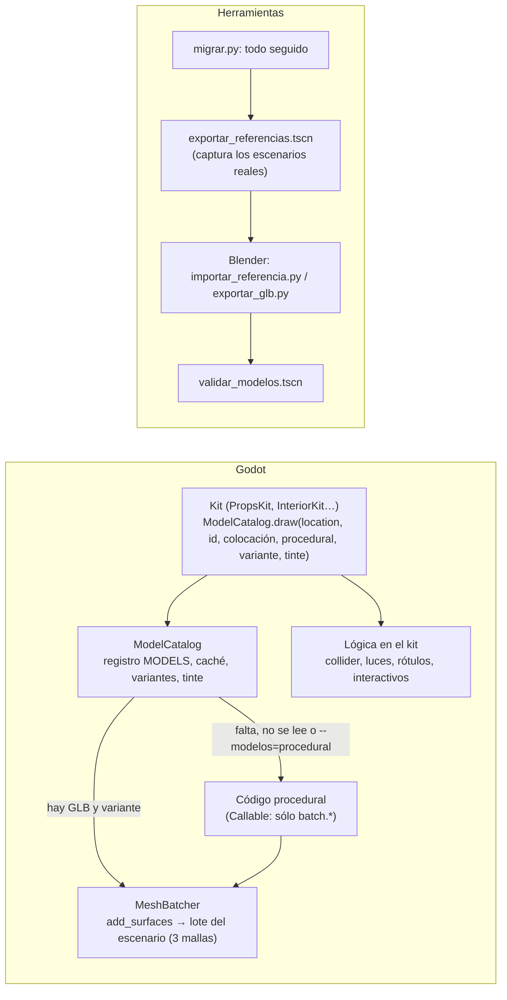

# 9. Sistema de modelos externos (arquitectura implementada)

Cómo está hecho el sistema que dibuja las piezas con modelos de Blender, y cómo se añade un modelo
nuevo. Las reglas que debe cumplir cada modelo están en
[05-estandares.md](05-estandares.md#contrato-de-compatibilidad-de-los-modelos-sesión-3).

## Piezas



| Pieza | Archivo | Qué hace |
| --- | --- | --- |
| `ModelCatalog` | `scripts/world/model_catalog.gd` | Registro (`MODELS`), carga y caché de los GLB, variantes, tinte, interruptor `enabled` y modo captura |
| `MeshBatcher.add_surfaces` | `scripts/world/mesh_batcher.gd` | Fusiona triángulos importados en el lote con la colocación, el tinte y la misma variación de tono que `face` |
| `MeshBatcher.shaded` | ídem | Variación de tono por cara a partir de su centro (R5) |
| Captura de referencias | `tools/modelos/exportar_referencias.tscn` | Construye todos los escenarios con `ModelCatalog.capturing` y escribe `blender/referencias/<id>.json` |
| Validación | `tools/modelos/validar_modelos.tscn` | Comprueba cada modelo registrado y escribe OK / AVISO / ERROR |
| `.blend` desde la referencia | `blender/scripts/importar_referencia.py` | Colecciones `Exportar` (un objeto por variante) y `Referencia` |
| Exportación | `blender/scripts/exportar_glb.py` | Comprueba, exporta con opciones fijas, color en sRGB, registro con `sha256` |
| Proceso completo | `blender/scripts/migrar.py` | Referencias → `.blend` (si falta) → GLB → importación → validación |
| Pruebas | `tests/unit/test_models.gd`, `test_mesh_batcher.gd` | Ver abajo |

## API para los kits

```gdscript
## Dibuja la pieza `id`: con su modelo si lo hay; si no, con `procedural`.
ModelCatalog.draw(location, id, transform, procedural, variant := "", tint := Color.WHITE) -> bool
## Lo mismo para un lote sin escenario (los pivotes de CharacterModel).
ModelCatalog.draw_in(batch, id, transform, procedural, variant := "", tint := Color.WHITE) -> bool
## Clave de variante a partir de medidas: Vector3(1.6, 0.76, 0.9) → "160x76x90".
ModelCatalog.size_key(size) -> String
```

- `transform` es relativa al `batch.xform` activo: una pieza que ya fija su propio `xform` (las
  que giran con `yaw_degrees`) pasa `Transform3D.IDENTITY`; una que dibuja en `where` pasa
  `Transform3D(Basis.IDENTITY, where)` o con su giro.
- `procedural` recibe el tinte y sólo llama a `batch.*`. **Nada de** `collider`, `solid`,
  `add_point_light`, `add_sign` ni `add_interactable` dentro: eso va después, en el kit, y no
  depende del modelo. La captura lo comprueba.
- Patrón de una pieza migrada:

```gdscript
static func chair(location: LocationBase, where: Vector3, yaw_degrees: float = 0.0, color: Color = Palette.WOOD) -> void:
	var previous := location.batch.xform
	location.batch.xform = previous * Transform3D(Basis(Vector3.UP, deg_to_rad(yaw_degrees)), where)
	var procedural := func(tint: Color) -> void: _chair_mesh(location.batch, tint)
	ModelCatalog.draw(location, "silla", Transform3D.IDENTITY, procedural, "", color)
	location.collider(Vector3(0.0, 0.5, 0.0), Vector3(0.5, 1.0, 0.5))   # igual que antes
	location.batch.xform = previous
```

## Variantes y tinte

- **Variantes:** una pieza con medidas por parámetro usa una clave de variante por medida
  (`size_key`). Todas las variantes van en un solo `.blend` y un solo GLB, un objeto cada una. La
  captura falla si dos usos con la misma clave no dibujan lo mismo (falta un parámetro en la
  clave). Una medida que el GLB no tenga se dibuja con el código procedural.
- **Tinte:** si la pieza recibe un color (la tapicería de un sillón), el kit lo pasa como `tint`.
  La captura dibuja la pieza con tinte blanco y gris: las caras que cambian son las teñidas
  (material `vs_tinte`) y guardan como color el **factor** (`color.darkened(0.3)` con tinte blanco
  = gris 0,7). En el juego, color = factor × tinte. Sólo vale para colores proporcionales al
  tinte (`darkened`, no `lightened`); la captura avisa si no lo son.

## Pruebas automáticas

| Prueba | Qué garantiza |
| --- | --- |
| `test_locations_match_with_and_without_models` | Cada escenario da los mismos polígonos (1 mm, área, color a 1/255, cara frontal) y las mismas colisiones con modelos y en modo procedural |
| `test_registered_models_are_complete` | Cada modelo registrado tiene GLB, referencia, todos los objetos que piden los escenarios y código de respaldo |
| `test_*_falls_back*`, `test_invalid_model_falls_back` | Sin GLB, con un archivo que no es un modelo o en modo procedural, la pieza se dibuja con su código y conserva su colisión |
| `test_plaza_keeps_its_batches` | Tres mallas y una sola colisión estática (`Colisiones`) |
| `test_variants_and_tint`, `test_capture_checks_procedural_parts` | Variantes por objeto, origen como pivote, color = factor × tinte; la captura detecta caras teñidas y rechaza lógica dentro de `draw` |
| `test_mesh_batcher` | La variación de tono no depende del orden |

## Añadir un modelo nuevo (mueble, accesorio o pieza de escenario)

1. **Separar lo visual en el kit.** Mover las llamadas `batch.*` de la pieza a una función
   `_<pieza>_mesh(batch, ...)`. Si usaba `location.solid(c, s, color, yaw)`, partirlo en
   `batch.box(c, s, color, yaw)` (dentro) y `location.collider(c, s, yaw)` (fuera).
2. **Llamar a `ModelCatalog.draw`** con un id nuevo, la colocación, el `Callable`, la variante
   (si tiene medidas por parámetro) y el tinte (si recibe un color).
3. **Registrar el id** en `ModelCatalog.MODELS` con `categoria`, `objeto` y `fiel: true`.
4. **Ejecutar** `python blender/scripts/migrar.py --ids <id>` desde la raíz del repositorio.
   Crea `blender/referencias/<id>.json`, `blender/fuentes/<categoría>/<id>.blend`,
   `assets/modelos/<categoría>/<id>.glb` (+ `.import`) y `blender/registro/<id>.json`, y valida.
5. **Pruebas:** `godot --headless --path new-game-project res://tests/test_runner.tscn -- --filtro=test_models`
   y después la batería completa.
6. **Commit** con la fuente, el GLB, el `.import`, el registro, la referencia, el kit y `MODELS`.

## Retocar un modelo en Blender

1. Abrir `blender/fuentes/<categoría>/<id>.blend`. Editar sólo la colección `Exportar`; la
   colección `Referencia` enseña la pieza original y sus colisiones.
2. Mantener el origen de cada objeto, el frente (−Y) y la caja (±5 cm). Material `vs_opaco`,
   `vs_brillo` o `vs_tinte`; color en el atributo `Color`.
3. Guardar y ejecutar `python blender/scripts/migrar.py --ids <id>` (no rehace el `.blend`).
4. Poner `fiel: false` en `MODELS` (el modelo ya no es copia exacta) y comparar con capturas.

## Problemas frecuentes

| Síntoma | Causa y solución |
| --- | --- |
| La pieza sale con el código procedural y un aviso «falta …glb» | No se ha exportado o no se ha importado: `migrar.py --ids <id>` |
| «no tiene el objeto X_variante» | Se usa una medida nueva: `migrar.py --ids <id>` la añade (si el `.blend` ya existe, con `--forzar` o añadiendo el objeto a mano) |
| «la parte procedural registra colisiones o nodos» | Hay un `collider`/`solid`/luz/rótulo dentro del `Callable`: sacarlo fuera de `draw` |
| «la variante se dibuja distinta en A y en B» | La clave de variante no incluye todos los parámetros que cambian la forma |
| Colores más claros en Blender que en el juego | El atributo no es `Color` o no está en lineal; el `.blend` creado por `importar_referencia.py` ya lo hace bien |
| `test_locations_match…` falla tras retocar un modelo | Esperado si el modelo ya no es copia exacta: `fiel: false` |
| Hay que volver atrás sin tocar Git | `-- --modelos=procedural` al lanzar, `ModelCatalog.enabled = false`, o quitar el id de `MODELS` |

## Revisión del acoplamiento entre lo visual y lo lógico (sesión 3)

| Sistema | Estado | Cambio |
| --- | --- | --- |
| `MeshBatcher` | Sólo geometría | `add_surfaces` (colocación, tinte, tono), `recording`, `shaded` |
| `PropsKit`, `InteriorKit`, `BuildingKit` | Cada pieza mezclaba `batch.*` con `collider`/`solid`/luces/rótulos | Patrón `ModelCatalog.draw` + parte procedural `_<pieza>_mesh`; `solid` se parte en `batch.box` + `collider`. Se aplica pieza a pieza en las sesiones 4–6 |
| `LocationBase` | Lote, colisiones (`Colisiones`), navegación, puntos, NPC | Sin cambios: las colisiones siguen registrándose en `build()` y la navegación se hornea con ellas |
| `Interactable`, `ClueObject`, `LocationExit`, `RestPoint` | Nodos con posición propia, sin malla | Sin cambios: no dependen de ninguna malla |
| `Npc` | Rutinas, navegación y puntos del escenario | Sin cambios en la sesión 3; en la 7 sólo pasa su id a `CharacterModel.build` |
| `CharacterModel` | Seis pivotes con malla procedural y animación por código | Sin cambios en la sesión 3; en la 7 cada pivote toma su malla con `ModelCatalog.draw_in` |
| Guardado (`SaveSystem`) | Guarda escenario, posición, pistas, marcas y estado de NPC | Sin cambios: ningún id de modelo ni nombre de nodo visual se guarda |
| Mapa (`TownMap`, `test_map`) | Lee las colisiones de `Colisiones` y la huella de `BuildingKit.body` | Sin cambios: `body` sigue procedural |

Nada de lo anterior se reescribió: el único punto de unión nuevo es `ModelCatalog.draw` dentro de
cada función de kit.
