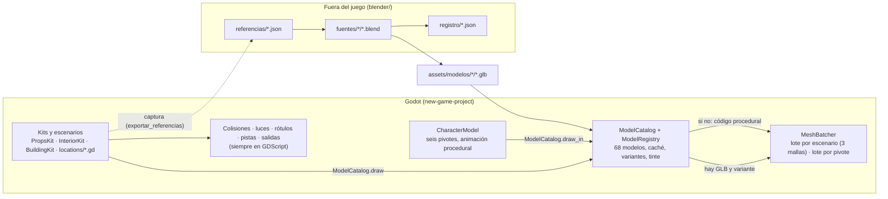

# 14. Sesión 8: integración, rendimiento y estado final

Rama `feature/blender-integracion`, creada desde el cierre de la sesión 7 (`de0f6c5`). Revisa todo
lo hecho desde la sesión 2, lo mide y deja el procedimiento listo para seguir.

## 1. Arquitectura definitiva

- **Lo visual se sustituye, lo lógico no se toca.** Cada pieza migrada se dibuja con
  `ModelCatalog.draw` (o `draw_in` en los pivotes de un personaje); su colisión, luz, rótulo,
  pista o salida sigue en el kit, en el mismo orden.
- **Sin nodos nuevos.** Los modelos se fusionan en el lote del escenario con los mismos tres
  materiales: un escenario sigue siendo tres mallas; un personaje, seis.
- **Respaldo siempre disponible.** Si falta el GLB, no se puede leer, no trae la variante pedida o
  se lanza con `-- --modelos=procedural`, la pieza se dibuja con su código de siempre.
- **Godot no necesita Blender.** Los `.blend` viven en `blender/`, fuera del proyecto; el juego sólo
  lee los GLB importados (`verificar.ps1` importa el proyecto sin Blender).

Detalle de la API, el contrato y el proceso: [09-sistema-de-modelos.md](09-sistema-de-modelos.md) y
[05-estandares.md](05-estandares.md#contrato-de-compatibilidad-de-los-modelos-sesión-3).

## 2. Revisión de la arquitectura (8.1)

| Componente | Revisión | Cambio en la sesión 8 |
| --- | --- | --- |
| `MeshBatcher.add_surfaces` | Calculaba tono, normal y color por vértice | **Por triángulo** (`a1d011f`): construir la plaza con modelos pasa de 50,0 a 28,5 ms |
| Pruebas de `test_models` | Tres pruebas repetían la captura de escenarios y personajes | Un solo `_capture_everything` (`216ae91`) |
| `validar_modelos` | Avisaba de la reducción intencionada de un modelo «optimizado» | Ya no avisa (`5d0e6e2`) |
| `ModelCatalog`, `ModelRegistry`, scripts de Blender, kits | Sin duplicación ni complejidad innecesaria | Sin cambios |
| Nombres, escala, orientación, materiales, colisiones, animaciones | Comprobados por las pruebas y por `validar_modelos` | Sin cambios |

## 3. Inventario final (8.2)

[INVENTARIO_MODELOS.md](INVENTARIO_MODELOS.md), generado con `python blender/scripts/inventario.py`:
para cada modelo, categoría, variantes, usos, escenarios o personaje, script que lo usa (con su
respaldo procedural), triángulos, colisiones del kit, tinte, brillo, fidelidad y estado.

| Categoría | Modelos | Usos en el juego |
| --- | --- | --- |
| Atrezo (`PropsKit`) | 10 | 42 |
| Mobiliario (`InteriorKit`) | 16 | 70 |
| Arquitectura (`BuildingKit`) | 5 | 42 |
| Piezas propias de escenarios | 27 | 37 |
| Personajes | 10 | 60 pivotes |
| **Total** | **68** | **251** |

Todos «migrados» (con `.blend`, GLB e importación). 67 son copia exacta de su pieza; la estantería
está «optimizada» (sin caras ocultas). Ninguno está «parcialmente migrado».

**Pendiente de migrar (decisión de la auditoría o sin valor hoy):** suelos, aceras, vías, paredes,
barreras, muretes, setos, alfombras, el cuerpo de los edificios (`BuildingKit.body`: su huella la
copia el mapa) y las piezas que no son modelos (marcador de interacción, rótulos de texto, lluvia,
entorno).

## 4. Rendimiento (8.3)

Medido en este equipo con `tools/modelos/medir_rendimiento.tscn` (sin ventana, 6 repeticiones) y
con `tests/visual/captura.tscn --stats` (1280 × 720, calidad alta). No se dan FPS: lanzado desde la
terminal, el juego va fijo a 30 FPS en este portátil con y sin modelos.

| Escenario | Triángulos opacos (procedural → modelos) | Llamadas de dibujado | Primitivas por fotograma (procedural → modelos) | Construcción en caliente, ms (procedural → modelos) | En frío con modelos, ms |
| --- | --- | --- | --- | --- | --- |
| Plaza | 6.361 → 6.361 | 236 = 236 | 99.972 → 99.972 | 33,5 → 28,0 | 106,5 |
| Café | 3.920 → 3.920 | 235 = 235 | 34.910 → 34.910 | 16,8 → 17,3 | 75,3 |
| Mansión | 6.752 → **5.558** | 327 = 327 | 140.956 → **118.270** (-16 %) | 35,7 → 24,0 | 110,3 |
| Archivo | 13.082 → **9.342** | 226 = 226 | 99.872 → **73.692** (-26 %) | 64,5 → 38,5 | 90,4 |
| Estación | 2.394 → 2.394 | 230 = 230 | 29.676 → 29.676 | 11,4 → 11,3 | 51,7 |
| Diez personajes | 3.450 → 3.450 | 6 por personaje | — | 20,8 → 16,9 | 62,1 |

- «En frío» es la primera vez que se construye el escenario en una partida (incluye leer los GLB);
  después, los modelos están en la caché y construir con ellos cuesta lo mismo o menos que el
  código procedural.
- **Memoria:** la caché con los 68 modelos cargados ocupa 3,1 MB de memoria estática. Los GLB
  pesan 1,9 MB con sus `.import` (`assets/modelos/`); las fuentes `.blend`, 6,4 MB (fuera del
  juego). En la tarjeta gráfica no hay mallas nuevas: los modelos van en el mismo lote.
- El cuello de botella sigue siendo el de antes (luces con sombra y posproceso), no la geometría.

## 5. Funcionamiento del juego (8.4–8.6)

Comprobado con la batería (con los modelos activos, que es como arranca el juego) y con
`verificar.ps1 -ConVentana` en una copia limpia de la rama:

| Sistema | Cómo se comprueba | Resultado |
| --- | --- | --- |
| Movimiento, cámara, colisiones, caídas | `test_player`, `test_world_bounds`, `test_fall_guard`, `test_world` | Correcto |
| Navegación y NPC (café y mansión incluidos) | `test_location_navigation`, `test_npc*`, `test_cafe_first_visit` | Correcto |
| Interacciones, pistas, deducción | `test_evidence`, `test_investigation`, `test_board*`, `test_journal` | Correcto |
| Diálogos y eventos narrativos | `test_dialogue*`, `test_story` | Correcto |
| Transiciones entre escenarios | `test_world` (salidas a apariciones reales), `test_integration`, `test_save_navigation` | Correcto |
| Mapa | `test_map` (compara la ilustración con las colisiones), `test_map_screen` | Correcto |
| Guardado manual, automático y carga | `test_save*`, `test_autosave`, reinicios de `verificar.ps1` (guardar en un proceso, cargar en otro) | Correcto |
| Ajustes visuales, filtros, menús, controles | `test_settings*`, `test_visual_filters`, `test_graphics_quality`, `test_main_menu`, `test_pause_menus`, `test_controls*` | Correcto |
| Audio (pasos con `stepped`) | `test_audio` | Correcto |
| Cinemáticas | La única es la introducción narrativa (`Game.play_intro`). Las pruebas arrancan la partida sin ella; se comprobó con una captura (`captura.tscn -- --intro`): la estación con el vagón, la marquesina y el detective de Blender, y el primer texto | Correcta (captura) |
| Inventario | No existe un sistema de inventario (`clue_inspector.gd`: «No es un inventario»): las pruebas son pistas del expediente | No aplica |
| Partida completa a mano con ratón, teclado y mando | **No ejecutada** en esta sesión | Pendiente |

Guardado: ningún archivo del sistema de guardado ha cambiado desde `main` y ningún id de modelo
se guarda; las partidas del jugador no se han tocado.

## 6. Recuperación y respaldo (8.8)

Pruebas controladas, sin borrar archivos del usuario (se redirige la ruta del modelo en memoria):

| Caso | Prueba | Resultado |
| --- | --- | --- |
| GLB ausente | `test_mailbox_falls_back_when_model_is_missing`, `test_missing_character_model_falls_back` | La pieza o el personaje se dibujan con su código y conservan colisión y pivotes |
| Archivo que no es un modelo | `test_invalid_model_falls_back` (apunta el buzón a `icon.svg`) | Código procedural, sin error |
| Variante que el GLB no trae | `test_missing_variant_falls_back` | Esa medida con su código, las demás con el modelo |
| Modo procedural global | `test_missing_or_disabled_model_falls_back`, `-- --modelos=procedural` en las capturas | Todo como antes de Blender |

**Cómo recuperar el sistema si falta un recurso:**

1. Sin tocar nada, el juego ya funciona: cada pieza sin modelo usa su código (con un aviso en la
   consola).
2. Si falta un GLB pero está su `.blend`: `python blender/scripts/migrar.py --ids <id>`.
3. Si falta el `.blend`: `python blender/scripts/migrar.py --ids <id>` lo vuelve a crear desde la
   pieza procedural (copia exacta; los retoques a mano se perderían: están en Git).
4. Para volver a la versión procedural sin Git: quitar el id de `ModelRegistry.MODELS`.

## 7. Limpieza (8.9)

- Sin archivos temporales en el repositorio (`__pycache__` y copias `.blend1` están ignorados; la
  herramienta de depuración usada en la sesión 4 se borró antes de confirmar nada).
- `project.godot` y `scenes/main/main_menu.tscn` no han cambiado en ninguna de las ocho sesiones.
- El proyecto se abre e importa sin Blender (paso «Importación» de `verificar.ps1`).
- Se conservan todas las herramientas: `migrar.py`, `importar_referencia.py`, `exportar_glb.py`,
  `optimizar_ocultas.py`, `inventario.py`, `exportar_referencias.tscn`, `validar_modelos.tscn`,
  `huella_escenarios.tscn` y `medir_rendimiento.tscn`.

## 8. Cómo crear un modelo nuevo

**Un mueble o accesorio nuevo** (por ejemplo, un perchero):

1. En `InteriorKit` (o `PropsKit`), escribir `coat_rack(location, where, yaw)` con su parte
   visual en `_coat_rack_mesh(batch)` y llamarla con `ModelCatalog.draw(location, "perchero",
   ..., procedural)`; la colisión, después, con `location.collider`.
2. Usarlo en un escenario y comprobar el aspecto con el código procedural.
3. Registrar `"perchero": {"categoria": "mobiliario", "objeto": "Perchero", "fiel": true}` en
   `ModelRegistry`.
4. `python blender/scripts/migrar.py --ids perchero` (crea el `.blend`, el GLB y valida).
5. Retocarlo en Blender si se quiere (`fiel: false`) y volver a ejecutar `migrar.py`.
6. Pruebas (`--filtro=test_models` y la batería) y commit.

**Un personaje nuevo:** añadir su entrada en `data/characters.json` con su `model` (aspecto), su
rutina en `schedules.json`, y registrar `"personaje_<id>"` (categoría `personajes`). `migrar.py
--ids personaje_<id>` crea el `.blend` con los seis pivotes montados mirando a +Y. Al retocarlo,
no mover el origen de ningún objeto (es su pivote) ni girar nada: la animación sigue siendo la de
`CharacterModel`.

Guía completa: [09-sistema-de-modelos.md](09-sistema-de-modelos.md).

## 9. Problemas conocidos

| Problema | Impacto | Qué hacer |
| --- | --- | --- |
| Primera construcción de un escenario más lenta (+26 a +75 ms) al leer sus GLB | Una sola vez por partida, durante el fundido de la transición | Si molesta, precargar `ModelCatalog` al empezar la partida |
| Cambiar el `look` de un personaje en `characters.json` deja su GLB desfasado | El personaje se vería con el aspecto anterior | Las pruebas lo detectan; `migrar.py --ids personaje_<id>` lo corrige |
| Al añadir un uso con una medida nueva, esa medida usa el código hasta exportarla | Ninguno visible (se ve igual) | `migrar.py --ids <id> --forzar` o añadir el objeto al `.blend` |
| `test_integration` es intermitente con el equipo cargado (R19) | Falsos fallos esporádicos | Repetir la batería |
| La batería y `verificar.ps1` comparten `user://pruebas_guardado` | Pruebas a la vez se estorban | No lanzarlas juntas |
| No se ha jugado una partida completa a mano tras la migración | Sólo lo cubren las pruebas automáticas | Partida de prueba antes de publicar |

## 10. Recomendaciones para seguir

1. **Mejoras artísticas en Blender**, pieza a pieza: empezar por lo que más se ve (fuente, árboles,
   coche, tren, personajes). Cada retoque: `fiel: false`, capturas antes y después, `migrar.py`.
2. **Retocar personajes** respetando pivotes, origen y frente (+Y); si se quiere compartir un
   cuerpo base entre personajes, materiales por papel teñidos con el `look` (propuesta de la
   sesión 1) sin cambiar `CharacterModel`.
3. **Optimizar más** sólo con medidas: el mismo criterio de caras ocultas sirve para otros
   muebles pegados a la pared (cómodas, archivadores), con su prueba de «optimizado».
4. **Texturas**: hoy los modelos se fusionan en el lote con color por vértice. Una pieza con
   textura necesitaría su propia instancia (llamadas de dibujado nuevas, a presupuestar en las
   pruebas).
5. Mantener el **inventario** regenerándolo tras cada cambio (`inventario.py`).
